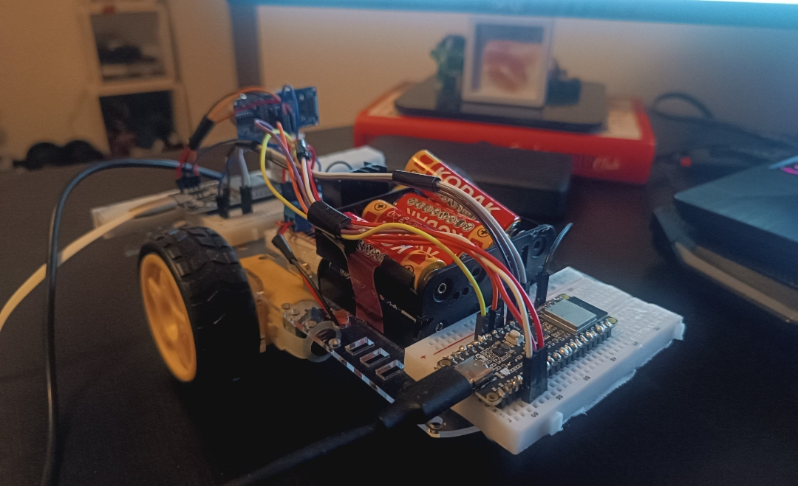

# ESP32 Wi-Fi RC Car

A two-motor robot car on an ESP32 that I drive from my phone's browser over home Wi-Fi.



## What it does

- **Drive from any browser.** `controller.html` is a single page with an on-screen joystick. It talks to the car over a WebSocket, so there's no app to install, and the phone stays on the home Wi-Fi with internet.
- **Steer like an RC car.** Push slightly to the side and the car curves; push fully sideways and it spins in place. Speed follows how far you push.
- **Stop on its own.** If the car hears nothing for 300 ms (phone locked, Wi-Fi drop, browser closed), it stops the motors.
- **Avoid obstacles (separate sketch).** `Autonomous_drive/` drives forward on its own, backs up and turns when an HC-SR04 sensor sees something closer than 40 cm. If it's still stuck after 3 turns, it tries the other direction.

## How it works

```
phone browser (controller.html)
   │  "left,right" every 75 ms, e.g. "75,-50"
   ▼  WebSocket, port 81
ESP32 (Remote_drive.ino)
   │  PWM + direction pins
   ▼
L298N motor driver ──► left and right DC motors
```

The browser turns the joystick position into a speed for each side (-100 to 100) and sends it 13 times a second while you hold the stick. The ESP32 maps that to PWM and sets the direction pins. The steady stream doubles as a heartbeat: when it stops, the 300 ms timeout kicks in.

### Why it's built this way

- **WebSocket instead of HTTP requests.** The first version sent an HTTP request per command. A WebSocket keeps one connection open, so commands arrive steadily, and the ESP32 doesn't have to run a web server at all.
- **The car joins the home Wi-Fi.** At first the car ran its own hotspot, and my phone lost internet while it was connected to it. Now the car joins the home network through WiFiManager, so no Wi-Fi password is written in the code.
- **A short brake before reversing.** Going straight from forward to backward made the motors fight each other. The controller now stops for 80 ms first.
- **More batteries.** With 4 AA cells the car was weak: the L298N loses about 2 V, so the motors got only about 3 V once the batteries sagged. I added two more cells: 6 AA in series across two holders, 10.2 V measured at the driver.

## Hardware

| Part | Notes |
|---|---|
| ESP32 dev board (ESP32-WROOM-32) | Powered from a USB power bank |
| L298N motor driver | Motor power from the battery pack |
| 2 DC motors and a chassis | |
| 6 AA batteries | Two holders wired in series, about 10 V |
| HC-SR04 ultrasonic sensor | Only for the obstacle-avoidance sketch |

The ESP32 and the motors use separate power sources with a **shared ground**.

### Wiring

| ESP32 pin | Connects to |
|---|---|
| 21 | L298N IN1 (left motor direction A) |
| 19 | L298N IN2 (left motor direction B) |
| 18 | L298N IN3 (right motor direction A) |
| 23 | L298N IN4 (right motor direction B) |
| 25 | L298N ENA (left motor speed, PWM) |
| 26 | L298N ENB (right motor speed, PWM) |
| 13 | HC-SR04 TRIG (obstacle sketch only) |
| 14 | HC-SR04 ECHO (obstacle sketch only) |

## Build your own

1. **Install** the Arduino IDE with ESP32 board support, then two libraries from the Library Manager: **WiFiManager** (tzapu) and **WebSockets** (Markus Sattler).
2. **Upload** `Remote_drive/Remote_drive.ino` with the board set to **ESP32 Dev Module**.
3. **Connect it to your Wi-Fi.** On first boot the car opens a hotspot called `ESP32-Car-Setup`. Join it from your phone, pick your home network in the page that opens (or go to `192.168.4.1`), and save. The car remembers it. If nobody configures it within 3 minutes, it restarts and tries again.
4. **Drive.** Open `controller.html` in a browser on the same network, enter `esp32-car.local` (or the IP address the Serial Monitor prints at 115200 baud) and press Connect.

To check the sensor on its own before trying the autonomous sketch, upload `HC_SR04_Test/HC_SR04_Test.ino` and watch the distances in the Serial Monitor.

### Settings you'll probably change

All of these are at the top of `Remote_drive/Remote_drive.ino`:

| Setting | Now | What it does |
|---|---|---|
| `LEFT_MOTOR_REVERSED` / `RIGHT_MOTOR_REVERSED` | `true` / `false` | Flip one if a wheel spins the wrong way |
| `MIN_PWM_OUTPUT` / `MAX_PWM_OUTPUT` | 100 / 115 | Speed range out of 255. Kept low for driving indoors; raise the max for more speed |
| `SAFETY_TIMEOUT_MS` | 300 | How long without a command before the car stops |
| `MDNS_HOSTNAME` | `esp32-car` | The `.local` name |

The joystick's dead zone and steering curve are at the top of the script in `controller.html`.

## Troubleshooting

- **`esp32-car.local` doesn't resolve.** Use the IP address from the Serial Monitor. On Android and older Windows, `.local` names often don't work.
- **Connect fails.** The phone has to be on the same Wi-Fi as the car. Check that the Serial Monitor says `WebSocket server started on port 81`.
- **A wheel turns the wrong way.** Flip its `_REVERSED` setting, or swap that motor's two wires.
- **The car barely moves.** Check the batteries first, then raise `MAX_PWM_OUTPUT`. Test with the wheels off the ground.
- **To set up a different Wi-Fi network,** uncomment `wifiManager.resetSettings();` in `setup()`, upload once, then comment it out again and upload.

## Known limitations

- **No password on the controls.** Anyone on the same Wi-Fi who opens `controller.html` can drive the car, and the setup hotspot is open. That's fine for a toy at home, not for anywhere else.
- **The two modes are separate sketches.** Switching between remote control and obstacle avoidance means uploading a different program.
- **Obstacle avoidance works, but not well.** In a dead end with walls on three sides it keeps turning instead of finding the way out. With one sensor pointing forward it also can't see to the sides or behind, so it can back into things.
- **The L298N wastes a lot of battery** as heat. A MOSFET driver like the TB6612FNG would give the motors more of the voltage.

## Project files

| Path | What it is |
|---|---|
| `Remote_drive/` | Remote-control firmware: Wi-Fi, WebSocket server, motor control |
| `controller.html` | The joystick page you open in a browser |
| `Autonomous_drive/` | Obstacle-avoidance firmware |
| `HC_SR04_Test/` | Sensor test sketch |
| `LICENSE` | MIT license |

## How it came together

- **2 Nov 2025:** first version, controlled over HTTP with a safety stop.
- **7 Nov:** switched to a WebSocket and home Wi-Fi with WiFiManager.
- **26 Nov:** 360-degree analog joystick.
- **28 Nov:** HC-SR04 sensor and the obstacle-avoidance sketch.
- **4 Dec:** proportional speed, 6 AA batteries and an indoor speed limit.

I built this with Claude Code as a pair programmer; the decisions, wiring and testing are mine.

## License

[MIT](LICENSE)
